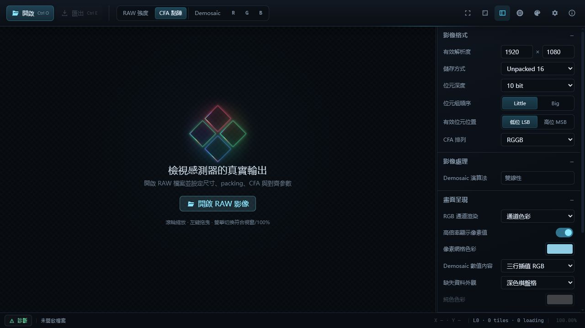

<p align="center">
  
</p>

<h1 align="center">eRAW</h1>

<p align="center">面向 SoC 與影像感測器適配工作的 RAW 影像檢視、診斷與格式轉換工具。</p>

<p align="center">
  <a href="https://github.com/woooooooooolf/eRAW/actions/workflows/ci.yml"></a>
  <a href="LICENSE"></a>
  
  <a href="https://tauri.app/"></a>
</p>

<p align="center">
  <a href="README.md">简体中文</a> · <a href="README.en.md">English</a> · 繁體中文 · <a href="README.ja.md">日本語</a> · <a href="README.es.md">Español</a> · <a href="README.fr.md">Français</a> · <a href="README.de.md">Deutsch</a>
</p>

## 介面預覽



## 下載

請從 [GitHub Releases](https://github.com/woooooooooolf/eRAW/releases/latest) 下載最新 Windows x64 版本並閱讀更新說明。

Release EXE 目前未使用 Authenticode 簽章，Windows 可能顯示 SmartScreen 提示。請僅從 Latest Release 下載，並使用版本隨附的 SHA-256 清單驗證檔案。

## 核心特色

- 支援 RAW8、16-bit 容器 RAW9–RAW16，以及 MIPI RAW10/12/14。
- 支援 Mono、四種 Bayer 排列與四種 Quad CFA 排列。
- 可設定有效尺寸、檔案標頭偏移、列/影格步幅與對齊，並瀏覽多影格檔案。
- 提供 RAW 強度、CFA、Remosaic、Demosaic 與 R/G/B 單通道顯示。
- 使用分級分塊、LOD 與 GPU 圖塊快取流暢檢視大型影像。
- 支援縮放、平移、像素定位，以及原始 CFA 通道與 DN 值讀取。
- 提供九套介面主題和七種介面語言，可於執行期間即時切換。

## 格式與顯示能力

| 類別 | 目前支援 |
| --- | --- |
| 儲存方式 | Unpacked 8、Unpacked 16、MIPI RAW10、MIPI RAW12、MIPI RAW14 |
| 位元深度 | RAW8–RAW16；MIPI 模式的位元深度由儲存方式決定 |
| CFA | Mono、RGGB、BGGR、GBRG、GRBG 及對應的四種 Quad CFA |
| 位元組配置 | Little/Big Endian、LSB/MSB 有效位元、標頭偏移、列/影格步幅與對齊 |
| 影像處理 | Quad CFA 重排、同色雙線性重建、雙線性 Demosaic |
| 檢查工具 | 多影格導覽、縮放與平移、像素網格、座標、CFA 通道和 DN |

檢視路徑會盡量容忍截斷或不完整資料，並明確顯示診斷資訊；匯出路徑則採用嚴格驗證，避免產生語意不完整的結果。

## 匯出與擷取

- 轉換並匯出原始 CFA 資料，可處理裁切、padding、packed/unpacked 與位元組順序。
- 匯出目前影格的 Remosaic Bayer 或 RGB48 Interleaved 資料。
- 將畫布視窗或完整預覽圖儲存為 PNG，或複製到剪貼簿。

## 命令列與 AI 呼叫

可由終端、指令碼或 AI 指定 RAW 檔案、尺寸、存儲格式、位深、CFA 與初始檢視，每次呼叫開啟獨立視窗。請依實際分發檔案替換以下 EXE 名稱與輸入路徑。

```powershell
& '.\eRAW.exe' '.\result.raw' --width 1920 --height 1080 --packing unpacked16 --bit-depth 12 --cfa RGGB --mode demosaic
& '.\eRAW.exe' --check '.\result.raw' --width 1920 --height 1080 --packing unpacked16 --bit-depth 12 --cfa RGGB
& '.\eRAW.exe' --skill
```

目前開發版在關於頁左下提供「檢查更新」。只有點擊才於背景讀取 GitHub Latest 的重新導向標頭，不使用 GitHub API 或解析發佈 HTML；啟動、開啟 RAW 及關於頁均不自動檢查。關閉關於後檢查繼續，重新開啟保留進行中或最終結果，僅在目前行程有效。網路逾時會結束檢查，不阻塞影像操作；確認相容 ZIP 後由使用者點擊，交給預設瀏覽器下載。

僅重排的可逆性要求完整座標域對置換封閉、樣本全部可讀且沒有裁剪或有損位深映射；不保證還原原始檔案位元組。部分尺寸和 Phase 會在邊緣請求影像外像素。預覽及 CLI 預檢仍可使用並顯示處理邊界警告，預檢退出碼仍為 0；相關 Remosaic/RGB48 匯出拒絕不支援的範圍。請明確選擇內部裁剪或同色重建，程式不會自動改參數。同色重建屬於插值，仍需要所需顏色站點存在。

加入 `--check` 僅預檢參數、檔案存取與配置，不開啟視窗。說明與回饋一律使用易讀英文，供人類與 AI 修正錯誤；預檢通過不代表畫面已繪製。

`--skill` 列印編譯嵌入 EXE 的完整英文 SKILL.md 後退出，不安裝 skill、不修改 AI 設定。CLI 初始參數不自動儲存，之後使用者操作遵循一般 GUI 儲存規則。

完整參數與退出碼見[CLI 說明](docs/CLI.md)，AI 呼叫流程見[skill 原始檔](skill/eraw-viewer/SKILL.md)。

## 平台與技術棧

eRAW 目前以 Windows 為主要目標平台，並以 Tauri 2 建置：

- 前端：TypeScript、WebGL2、Canvas 2D、原生 HTML/CSS
- 後端：Rust、唯讀記憶體映射、二進位 Tauri IPC
- 執行階段相依項目：Windows WebView2 Runtime

## 從原始碼執行

需要 Node.js、Rust stable（最低 1.90）、Windows WebView2 和 Tauri 2 的系統建置相依項目。

```powershell
npm.cmd install
npm.cmd run tauri dev
```

## 檢查、測試與建置

```powershell
npm.cmd run check
npm.cmd run test:frontend
npm.cmd run build
cargo test --manifest-path src-tauri/Cargo.toml
npm.cmd run release
```

`npm.cmd run release` 會透過 Tauri CLI 建置包含前端資源的 Windows Release EXE。請勿以單獨的 `cargo build --release` 取代發布命令，因為它不會執行前端建置與資源嵌入流程。

## 工程文件

產品決策、系統架構、RAW 語意、渲染、測試與迭代流程請參閱[工程文件索引](docs/README.md)。

## 目前邊界

- eRAW 面向感測器原始資料診斷，不進行降噪、銳化、色彩校正、壞點修復等照片品質最佳化。
- 目前 Demosaic 演算法為雙線性。
- 支援矩形 ROI 選取、座標輸入，以及基於 L0 原始 CFA DN 的區域統計。
- 目前不提供通用批次處理流程。

## 維護與貢獻

專案目前以穩定性、缺陷修復與既有能力完善為主。歡迎可重現缺陷、相容性問題、文件與測試改進，以及不改變既有語意的局部最佳化。會顯著改變架構、處理流程或使用者行為的新功能通常不列為優先；如確有需要，請先說明問題邊界與長期維護成本。

範圍與提交流程請參閱[貢獻指南](CONTRIBUTING.md)；安全問題請遵循[安全策略](SECURITY.md)。

## 授權條款

eRAW 依 [GNU General Public License v3.0 or later](LICENSE) 發布。
