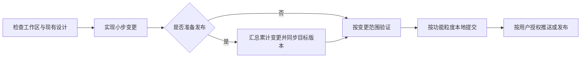

# 迭代、版本与发布流程

## 需求进入实现前

每轮迭代先判断：

- 是否符合“RAW 查看与传感器调试工具”的产品定位。
- 是否会让预览容错和导出严格性相互污染。
- 是否造成状态来源重复、跨层耦合或不可取消的耗时任务。
- 是否属于低频信息，应使用菜单、弹窗或覆盖层而非常驻占位。
- 是否可以通过人工验证显著降低无意义的自动化成本。

如果需求会改变产品边界、数据语义或架构依赖，应先讨论并形成明确决策再实现。

## Git 策略

- `master` 保持可构建、可测试。
- 大功能在 `codex/<feature>` 分支实现，回归通过后合并回 `master`。
- 每轮迭代按可解释、可验证的功能粒度形成一个或多个提交，提交信息使用中文。
- 同一功能直接关联的实现、测试和文档放在同一责任边界内；相互独立的变更分开提交，不按文件数量机械拆分或合并。
- 版本更新在准备发布时通常独立成提交，便于区分功能实现与发布快照；日常提交不要求提升版本号。
- 不修改或提交来源不明的用户文件；发现未跟踪文件时先确认其归属。
- 默认只提交本地；只有用户明确要求时才推送远端。

## 版本策略

版本号使用 `X.Y.Z`，分别称为主版本号、次版本号、修订号，参考 [SemVer 2.0.0](https://semver.org/lang/zh-CN/)。版本号标识可交付的软件版本，不作为开发轮次、提交次数或 CI 次数的计数器。

### 升版时机

- 日常开发按功能粒度验证并提交；一次发布可以累计多轮迭代、多个提交或多个 Pull Request，不要求每次修改后提升版本号。
- 准备正式发布时，汇总相对上一次正式发布的全部变更，按最高变更级别统一确定目标版本；同一发布不按所含迭代数重复递增。
- 如果候选版本已在未发布阶段提升，后续迭代继续累计；只有累计变更改变发布级别时才重新评估目标版本。
- 仅文档、注释或不影响交付行为的维护变更，不自动升版，也不单独触发发布；嵌入程序的帮助、翻译或其他资源发生变化并需要重新发布产物时，仍须使用新的发布版本。
- 升版、推送和发布是不同操作；升版不代表已获推送或发布授权，普通提交或 PR 合并也不自动创建标签或 Release。

### 变更级别

| 变更 | 版本处理 |
| --- | --- |
| 增加向后兼容的用户功能、CLI 能力或其他公开能力 | 提升 Y，Z 归零；不因功能实现较小而改用 Z |
| 向后兼容的缺陷修复、安全或兼容性修复，以及不增加公开能力、不改变既有语义的性能和界面局部优化 | 提升 Z |
| 不兼容的公开契约变更 | 先讨论兼容性与迁移方案；稳定版本应提升 X，并将 Y、Z 归零 |

eRAW 的公开契约包括 CLI 参数与退出码、RAW 数据及导出语义，以及用户已有配置的读取方式。用户明确说明主版本变更前，X 保持不变；不得仅因功能积累或准备发布而自动提升 X。当前处于 `0.y.z` 阶段，新增能力或经讨论确认的不兼容变更提升 Y，并在更新说明中明确影响；不能将不兼容变更作为普通修订隐藏在 Z 中。

### 开发构建与版本记录

- 本地构建以 Git 提交号和构建时间追溯；分发测试包时，在包名或随附说明中记录提交号、构建时间及必要的测试序号，并明确其为未发布的测试构建。测试轮次不要求递增正式版本号，也不得用测试包替换同版本的正式产物。
- 如需使用 `-rc.N` 等先行版本后缀，应先验证并适配 Tauri、版本同步检查、标签和发布打包流程；当前流程仍使用三段数字版本及 `Vx.y.z` 发布标签。
- 已发布版本的标签及产物保持不变，内容变化应使用新的发布版本；不回移标签或覆盖已有发布来复用版本号。
- 现有本地未发布版本不因本约定回退，不重写已有提交；后续从当前状态累计变更，准备发布时再统一评估。

例如，同一次发布前连续修复两个缺陷、再调整关于页样式，可以形成多个提交，最后只提升一次 Z；若累计变更还新增公开能力，则按 Y 级别统一发布。

确定发布版本后，必须同步更新：

- `package.json` 与 `package-lock.json`
- `src-tauri/Cargo.toml` 与 `Cargo.lock`
- `src-tauri/tauri.conf.json`
- `src/app.ts`
- 带版本的内置帮助标题、正文及对应测试断言
- 必要的工程文档；README 不展示软件版本号

## 一次完整迭代



仅修改工程文档且不影响程序嵌入资源时，检查内容一致性、相对链接和图表语法，并运行 `git diff --check`；不要求为此重建 EXE 或重复运行完整程序测试。涉及程序、依赖或构建流程时，按影响范围执行静态检查、测试、生产构建、Tauri Release 构建与独立 EXE 冒烟；正式发布执行下方完整验收。

涉及程序变更时的推荐命令：

```powershell
git status --short
npm.cmd run check
npm.cmd run test:frontend
npm.cmd run build
cargo test --manifest-path src-tauri/Cargo.toml
npm.cmd run release
```

自动化测试流程不得加入 `npm.cmd run dev`、`npm.cmd run tauri dev` 或其他常驻服务启动命令。交互或视觉检查应使用已构建的 Release EXE，并为启动、探测和关闭设置明确的时间边界。

不要用裸 `cargo build --release` 代替发布命令；它不会保证执行 Tauri 的前端构建和资源嵌入流程。

涉及 CLI 或启动流程的迭代，在 Release 构建后运行 `npm.cmd run test:cli`；采用重定向 stdout/stderr 的有限子进程验证 GUI 子系统 EXE 的英文反馈和退出码。CLI 文字统一使用英文，不随 GUI 七语目录切换；文件路径保持原文。多实例人工检查使用隔离的 WebView 测试目录，避免改写真实用户偏好。

## GitHub 自动化

- `.github/workflows/ci.yml` 在 `master` 推送、面向 `master` 的 Pull Request 和手动触发时运行前后端检查、测试、生产构建、独立 Release EXE 构建与 CLI 进程测试；发布工作流在打包前同样验证 CLI。
- 发布标签使用 `Vx.y.z` 格式，并且必须与仓库中的软件版本严格一致。
- 推送发布标签后，`.github/workflows/release.yml` 自动运行完整检查和 Tauri Release 构建，创建对应的 GitHub Release。
- 后续 Windows x64 Release 只上传 `eRAW-Vx.y.z-windows-x64.zip`；包内根目录包含同名 EXE、SHA-256 清单、SPDX SBOM 与第三方许可证文本。V0.6.0 及更早版本的现有资产保持不变。
- 普通提交和未推送的本地标签不会创建 GitHub Release。
- 测试构建通过不代表已发布；正式发布需用户明确授权，并按累计变更确定版本、更新说明和发布标签。

## 发布验收

发布前至少确认：

- `git diff --check` 无格式错误。
- TypeScript 检查、国际化测试、前端构建和全部 Rust 测试通过。
- Release EXE 能作为独立程序启动，不依赖 Vite 开发服务器。
- 关于页版本与构建时间正确。
- 没有把测试 RAW、`target/`、`dist/` 或用户临时文件纳入提交。
- 人工回归范围与本次风险相匹配。

推送后比较 `HEAD` 与 `origin/master`；提交差异必须为 `0 / 0`。网络异常时停止强行绕过，由用户恢复网络或手动推送后再核对。

## 翻译目录维护

随软件分发的 AI skill 维护在 `skill/eraw-viewer/SKILL.md`，正文统一英文且自包含；不要引入仅仓库可访问的必需引用。CLI 契约变化时同轮更新 `--help`、`docs/CLI.md`、skill、七语 README 与内置 CLI 帮助页。`--skill` 通过编译期嵌入保持单一来源，构建后以真实 EXE 校验完整输出和示例参数；打印 skill 不等于安装到 AI 客户端。

- 新增或修改用户可见文字时，同步补齐 `src/i18n.ts` 的七种语言，不提交空白占位。
- 静态界面文字必须通过显式 `data-i18n`、`data-i18n-title`、`data-i18n-aria-label`、`data-i18n-placeholder` 或 `data-i18n-help` 键绑定；不得从中文、英文或其他可见文字反向匹配消息键。
- 产品名、RAW/CFA/Packing/Remosaic/Demosaic、格式名、单位和按键保持行业惯用写法；普通说明文字应完整翻译。
- 带变量的消息只通过命名占位符传入数值，不拼接后端自然语言。
- 后端新增用户可见错误或警告时，先定义稳定代码和结构化参数，再在前端目录中映射；不要以任一语言的句子作为控制流条件。
- 变更目录或系统语言解析后运行 `npm.cmd run test:i18n`，并至少在最小窗口尺寸检查英文和一种长文本语言。
